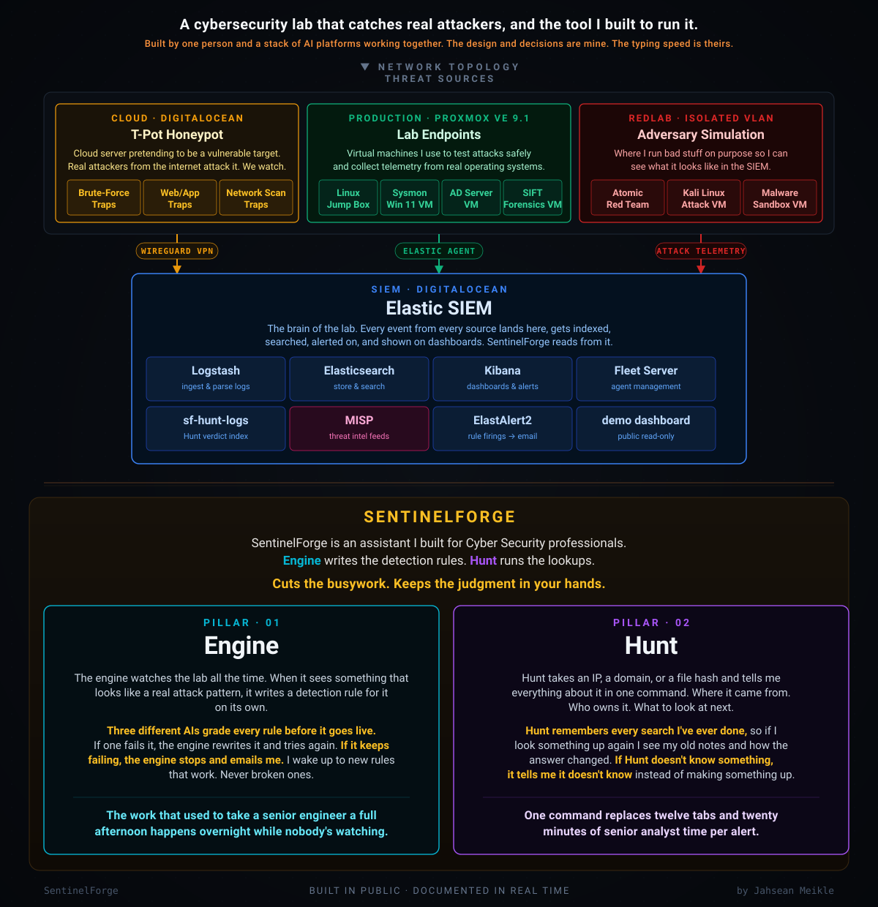

# SentinelForge

**A detection-as-code lab: Sigma rules mapped to MITRE ATT&CK, CompTIA Security+ and ISC2 CC objectives, NIST 800-53 and CIS v8 controls, with an AI-assisted rule generation and review pipeline.**

Author: Jahsean Meikle. License: MIT (see [LICENSE](LICENSE)).

## What this is

SentinelForge is a personal detection engineering project. It keeps detection logic in version control as Sigma rules, converts them to Elastic queries with pySigma, and deploys them to Kibana's detection engine through a gated pipeline. Each rule carries machine-readable tags that tie it to ATT&CK techniques, to Security+ SY0-701 and ISC2 CC exam objectives, and to NIST SP 800-53 and CIS Controls v8, along with short defender notes covering hardening, incident response and risk treatment.

It is a lab and portfolio project, not a product. Active rules are marked `status: experimental`; rules whose logic did not match their ATT&CK tag were retagged, split or marked `status: deprecated` (deploy disables a deprecated rule and never creates one). Nothing here claims to be deployed to any particular environment, and nothing has been run against a live Elastic, Kibana or GitHub instance (see [Known limitations](#known-limitations-and-what-is-not-verified)).

A short technical summary for a reviewer, with a table of claims and the file or test that backs each one, is in [docs/PROJECT_SUMMARY.md](docs/PROJECT_SUMMARY.md).

## Contents

- [Architecture](#architecture)
- [Quick start](#quick-start)
- [Configuration](#configuration)
- [Detections by ATT&CK tactic](#detections-by-attck-tactic)
- [Certification alignment](#certification-alignment)
- [Security model](#security-model)
- [CI/CD](#cicd)
- [Testing](#testing)
- [Known limitations and what is not verified](#known-limitations-and-what-is-not-verified)
- [Repository layout](#repository-layout)
- More detail: [setup](docs/SETUP.md), [architecture](docs/ARCHITECTURE.md), [bulk redeploy](docs/REDEPLOY.md), [project summary](docs/PROJECT_SUMMARY.md)

## Architecture

Full description: [docs/ARCHITECTURE.md](docs/ARCHITECTURE.md). Setup: [docs/SETUP.md](docs/SETUP.md).

```
 Sysmon / Windows telemetry --> Elastic Agent --> Elasticsearch
                                                      |
        +---------------------------------------------+
        |                       |                     |
   generate_rule.py        sf_hunt.py            rule_efficacy.py
   (autonomous rule        (IOC enrichment,      (alerts per rule)
    engine, review gate)    verdict, pivots)           |
        |                       |                      v
        v                       v               state/rule_efficacy.json
 detections/pending/       sf_web.py (FastAPI) <------+
        |                  dashboards + approve/reject
 approve.py / web approve
        |
        v
 detections/sigma/*.yml --> CI (GitHub Actions) --> validate_rule.py --> deploy_rule.py --> Kibana
        ^                                                                       |
 tools/tag_compliance.py                                                  alerts index
 docs/compliance/mapping.yml                                                    |
                                                                          ElastAlert 2 --> email
```

| Component | Role |
|---|---|
| `lab/` | Shared package. `lab.config`: settings from env. `lab.http`: one session factory with timeouts, capped retries (idempotent methods only) and TLS verification on by default. `lab.ecs`: the single Sigma to ECS conversion pipeline, including case-variant expansion. `lab.state`: JSON state files written atomically under a cross-process advisory lock; corrupt files are quarantined. `lab.es`: Elasticsearch search paged with a point in time (PIT) and `search_after`, failing loudly on partial pages. `lab.kibana_rule`: Kibana rule payloads, including the engine-owned field list used for updates. `lab.coverage`: ATT&CK coverage counted from the shipped rules. |
| `detections/sigma/` | The rule set, one Sigma file per detection. |
| `tools/tag_compliance.py` | Deterministic tagger. Reads `docs/compliance/mapping.yml`, writes certification, NIST and CIS tags plus a "Defender notes" block into each rule, and regenerates [docs/compliance/COVERAGE.md](docs/compliance/COVERAGE.md). `--check` fails CI on drift. |
| `generate_rule.py` | Autonomous rule engine. Reads recent events from Elasticsearch, asks an LLM to propose a Sigma rule, validates the model output before anything is written, and (with `WATER_REVIEW_GATE=true`) holds the rule for human approval. The gate is off unless that variable is set. |
| `validate_rule.py` | YAML lint, Sigma to Lucene conversion, a 7-day backtest against Elasticsearch (an unreachable Elasticsearch fails the rule), a vote by up to three models (Claude, Gemini, Ollama) run concurrently with a quorum of two valid votes, and a self-heal loop limited to three attempts. |
| `approve.py` and the web approve routes | Human review gate. Approving deploys; rejecting discards. |
| `deploy_rule.py` | Converts a rule and creates it in Kibana. On a 409 it reads the existing rule, checks that it is the same lineage (shared ATT&CK technique tag, unless `--allow-retag`), and updates only the engine-owned fields with `PATCH`. Deprecated rules are disabled, never created. `--delete <id>` retires a rule. |
| `tools/redeploy_all.py` | One-time bulk reconciliation of Kibana with the shipped rules; dry run by default. See [docs/REDEPLOY.md](docs/REDEPLOY.md). |
| `tools/ci_changes.py` | Plans a CI run from the git diff: changed, removed and retagged rules. |
| `water_hunt_trigger.py`, `sf_safety.py` | Optional path from a high-confidence hunt verdict to a rule proposal, behind provenance, score, age and daily-rate gates. |
| `sf_hunt.py` | Analyst IOC enrichment CLI: local cache, several threat-intel sources queried in parallel, deterministic weighted verdict, suggested pivots. |
| `sf_web.py` | FastAPI app serving the dashboards in `web/` and the JSON API (hunt, engine state, pending rules, token-gated approve/reject). |
| `rule_efficacy.py` | One aggregation query that reports how many alerts each deployed rule has produced. `generate_heatmap.py` writes an ATT&CK Navigator layer from the shipped rules. |
| `elastalert/` | ElastAlert 2 templates for email alerts on Kibana alerts. Rendered with `envsubst` by `elastalert/run.sh`. |
| `.github/workflows/` | `test.yml` (offline tests and tag check on GitHub-hosted runners) and `deploy-detections.yml` (validate, then deploy on push). |

## Quick start

Requires Python 3.11 or newer (CI uses 3.12; the suite was last run here on 3.14). Commands are for a POSIX shell; on Windows use `venv\Scripts\python`.

```bash
python -m venv venv
venv/bin/python -m pip install -r requirements-dev.txt   # pinned runtime + test dependencies
cp .env.example .env            # then fill in values; never commit .env

venv/bin/python -m pytest -q                       # offline test suite
venv/bin/python tools/tag_compliance.py --check    # exit 0 if tags and COVERAGE.md are current
venv/bin/python tools/readme_tables.py --check     # exit 0 if the generated README blocks are current
```

The test suite makes no network calls. Running the engine, validator, deployer or hunt tool for real needs a reachable Elastic stack and API keys; see [docs/SETUP.md](docs/SETUP.md). Commands that work without any service:

```bash
venv/bin/python tools/tag_compliance.py --write    # retag rules from docs/compliance/mapping.yml, rewrite COVERAGE.md
venv/bin/python tools/readme_tables.py --write     # rewrite the generated README blocks
venv/bin/python generate_heatmap.py                # ATT&CK Navigator layer -> docs/coverage_layer.json
venv/bin/python approve.py list                    # pending rules (reads state/pending_rules.json)
```

Commands that need Elastic, Kibana or API keys: `sf_hunt.py <ioc>` (also `scripts/sfhunt`), `generate_rule.py` (`scripts/sfengine`), `validate_rule.py <rule.yml>`, `deploy_rule.py <rule.yml>`, `rule_efficacy.py`, `tools/redeploy_all.py` (dry run reads Kibana), and the web app (`python -m uvicorn sf_web:app --host 127.0.0.1 --port 8000`; it starts without Elastic but approve/reject need `LAB_ADMIN_TOKEN`).

## Configuration

Settings come from environment variables; `python-dotenv` loads `.env`. The table lists the variables that change security behaviour or are needed for a first run; [docs/SETUP.md](docs/SETUP.md) has the complete list. `.env.example` lists every variable the code reads (optional ones commented out), and a test keeps it that way.

| Variable | Purpose | Default |
|---|---|---|
| `ELASTIC_URL` | Elasticsearch base URL (full URL with scheme). | none; missing value is a `ConfigError` |
| `ELASTIC_API_KEY` | API key for Elasticsearch and Kibana. Deploy refuses to call Kibana without it. | none |
| `KIBANA_URL` | Kibana base URL. | derived from `ELASTIC_URL` with port 5601 |
| `LAB_INSECURE_TLS` | `1` turns TLS verification off and logs a warning. | off (verification on) |
| `LAB_ADMIN_TOKEN` | Token for approve/reject in the web app, sent as `X-Admin-Token`. At least 16 characters or the routes are disabled. | unset (routes disabled) |
| `SF_ALLOWED_HOSTS` | Comma-separated `Host` header allowlist for `sf_web.py`. | `localhost,127.0.0.1,testserver` |
| `SF_AUTH_FAIL_LIMIT`, `SF_AUTH_FAIL_WINDOW` | Wrong admin tokens per client before lockout, and the window in seconds. | 5 per 300 s |
| `SF_HUNT_RATE_LIMIT`, `SF_HUNT_RATE_WINDOW` | Hunt calls per client per window in seconds. | 10 per 60 s |
| `SF_CASE_VARIANTS` | `0` turns off case-variant expansion in `lab.ecs`. | on |
| `WATER_REVIEW_GATE` | `true` holds generated rules for human approval. `run_engine.sh` sets it. | off |
| `ANTHROPIC_API_KEY`, `GEMINI_API_KEY`, `MODEL_NAME`, `OLLAMA_URL`, `OLLAMA_MODEL` | LLM access for generation and voting. A voter without a key or endpoint is skipped. | `MODEL_NAME` has a built-in default |

Generate an admin token with `python -c "import secrets; print(secrets.token_urlsafe(32))"`.

## Detections by ATT&CK tactic

Generated by `tools/readme_tables.py` from `detections/sigma/` and `docs/compliance/mapping.yml`; the counts below are computed from the rule files, not typed. The rule total counts every file in `detections/sigma/`, including deprecated rules, which are kept so Kibana can disable them. The defender columns are the per-technique text from the mapping; a few rules override it (see `rules:` in `mapping.yml`). The per-rule view with every tag is in [docs/compliance/COVERAGE.md](docs/compliance/COVERAGE.md).

Coverage history: an early version of this README stated 37 techniques. Independent review found rules whose logic did not match their ATT&CK tag; those were retagged, split or deprecated, and the count dropped to the current figure. The lower number is the accurate one.

<!-- BEGIN GENERATED: detections-table -->
41 Sigma rules covering 28 ATT&CK techniques and sub-techniques across 11 tactics (counted from `detections/sigma/`). Each row is one technique; the defender columns come from `docs/compliance/mapping.yml`.

| Tactic | Technique | Rules | Hardening | Incident response | Risk |
|---|---|---|---|---|---|
| Reconnaissance | T1595 | 1 | Keep externally exposed services to the minimum, block known scanning sources at the perimeter and collect connection logs centrally. | Confirm the source in threat intelligence, check which ports it reached and whether any connection succeeded, and block it if unwanted. | Accept: internet scanning is constant background noise; mitigate by reducing the exposed attack surface. |
| Execution | T1059.001 | 3 | Enable PowerShell script block and module logging, apply Constrained Language Mode, and allowlist approved scripts. | Collect script block logs, identify the download source and parent process, and quarantine any written files. | Mitigate: logging and language constraints; accept residual risk for administrators who need full PowerShell. |
| Execution | T1059.003 | 1 | Allowlist approved scripts, restrict cmd.exe and batch execution from user-writable paths, and log command lines. | Retrieve the batch file, review its contents, and trace its origin (download, email or share) before deletion. | Mitigate: script allowlisting; accept residual risk from legitimate admin automation. |
| Execution | T1105 | 2 | Filter outbound web access with a URL allowlist or proxy and block direct PowerShell downloads from untrusted hosts. | Retrieve and hash the downloaded file, block the source URL, and scan for execution of the payload. | Mitigate: egress filtering; accept residual risk for approved software update paths. |
| Execution | T1569.002 | 1 | Disable unnecessary services, restrict service creation to administrators, and baseline svchost service groups. | Inspect the new or modified service binary and parameters, preserve it, and remove persistence once scoped. | Mitigate: service allowlisting and least privilege; accept residual risk from legitimate administrative tooling. |
| Persistence | T1053.005 | 1 | Restrict scheduled task creation to administrators and alert on logon or startup triggered tasks created from user context. | Export the task definition, identify the action it runs, delete it once preserved, and hunt for the same task name elsewhere. | Mitigate: least privilege on task creation; accept the residual risk for approved software installers. |
| Persistence | T1546.011 | 7 | Disable application compatibility shim installation for standard users and audit AppCompatFlags registry changes. | Export the shim database and registry keys, remove the registration, and check the shimmed application for tampering. | Mitigate: configuration control; accept residual risk for legitimate compatibility fixes with change approval. |
| Defense Evasion | T1036.005 | 1 | Enforce application allowlisting so system utilities only run from their expected paths, and alert on path mismatches. | Hash and preserve the masquerading binary, compare it to the legitimate file, and hunt for the same hash across hosts. | Mitigate: allowlisting; accept residual risk where admins run copies of tools from non-standard paths. |
| Defense Evasion | T1055 | 1 | Enable anti-exploitation features and behaviour-based EDR, and constrain PowerShell with Constrained Language Mode and script block logging. | Isolate the host, capture memory of the injected process, and identify the payload source URL for blocking. | Mitigate: EDR and PowerShell constraints; residual risk accepted for unmanaged developer machines with compensating monitoring. |
| Defense Evasion | T1112 | 2 | Enforce secure configuration baselines through Group Policy and restrict reg.exe for standard users. | Record the key and value changed, revert it to baseline, and determine what process and user made the change. | Mitigate: configuration management; accept low-impact cosmetic changes with monitoring. |
| Defense Evasion | T1204.002 | 2 | Block macros from internet-sourced Office files, filter risky attachment types, and run phishing awareness training. | Isolate the host, retrieve the document and macro, identify the delivery email, and purge it from other mailboxes. | Mitigate: macro blocking and training; transfer part of the risk with email security services. |
| Defense Evasion | T1218.007 | 2 | Restrict msiexec to administrators or software distribution, block installs from user-writable paths, and apply application control. | Retrieve the MSI package, inspect its custom actions, and uninstall and remove artefacts after scoping. | Mitigate: application control; accept residual risk for approved silent deployments. |
| Defense Evasion | T1497.001 | 1 | Collect command-line audit logs and baseline which inventory scripts legitimately read hardware and virtualization registry keys such as the Disk Enum service key. | Identify the parent process and what ran next; malware that checks for a VM or sandbox usually exits or changes behaviour when it finds one, so look for that follow-up. | Accept: hardware inventory scripts read the same keys; use as a correlation signal. |
| Credential Access | T1003.002 | 1 | Remove standing local admin rights, randomise local admin passwords with LAPS, and alert on reg save of the SAM, SYSTEM and SECURITY hives. | Isolate the host, treat local and cached credentials as compromised and reset them, and preserve the saved hive files as evidence. | Mitigate: LAPS and least privilege reduce the value of dumped hashes; accept residual risk for documented backup tooling via the filter. |
| Credential Access | T1110.001 | 1 | Enforce account lockout, require MFA, ban weak passwords, and restrict net use to administrators. | Identify the targeted accounts and share, reset any account that may have succeeded, and block the source. | Mitigate: lockout and MFA; accept residual risk for legacy systems that cannot enforce MFA, with compensating monitoring. |
| Discovery | T1012 | 1 | Collect process-creation events with full command lines and baseline legitimate registry query tooling per host role. | Review the parent process chain and the same user's session for follow-on discovery or credential access. | Accept: low-impact discovery on its own; monitor and escalate when combined with other discovery or execution alerts. |
| Discovery | T1016 | 2 | Log DNS queries centrally and baseline which processes legitimately contact connectivity-check domains. | Identify the querying process and its parent, then check for proxy or C2 behaviour from the same host. | Accept: network configuration discovery is common noise; tune thresholds and keep the alert as a correlation signal. |
| Discovery | T1016.001 | 1 | Log command lines for cmd.exe children and restrict network utilities that standard users do not need. | Determine what launched cmd.exe, review commands run in the same session, and check outbound connections afterwards. | Accept with monitoring: connectivity checks are frequently benign; escalate only with other attacker behaviour. |
| Discovery | T1018 | 2 | Segment workstations from server networks and log net.exe usage with command lines. | Identify the account and host, review which systems were enumerated, and look for follow-on lateral movement. | Mitigate: segmentation limits what enumeration reveals; accept the residual discovery noise. |
| Discovery | T1033 | 4 | Collect command-line audit logs and restrict scripting engines to users who need them. | Check what spawned the scripting engine and whether it ran with user or elevated rights, then widen to the host timeline. | Accept: owner discovery is low-impact; the alert is valuable mostly as correlation context. |
| Discovery | T1049 | 1 | Log command lines for chained cmd.exe commands and restrict netstat-style tooling for standard users where practical. | Review the chained commands and parent process, then check for connections to unusual hosts from the same machine. | Accept: connection discovery is common; use as a correlation signal. |
| Discovery | T1069.002 | 1 | Review privileged group membership regularly, apply role-based access control, and log net.exe group enumeration. | Identify the account and host, review which groups were enumerated, and watch that account for privilege escalation. | Mitigate: tidy privileged groups to reduce what enumeration reveals; accept discovery noise. |
| Discovery | T1082 | 1 | Collect command-line audit logs and baseline legitimate inventory tooling. | Check the parent process and subsequent commands in the session; treat as reconnaissance and widen the hunt. | Accept: system discovery is low-impact and common; use for correlation. |
| Discovery | T1083 | 1 | Apply least-privilege file ACLs so recursive enumeration yields little, and log command lines. | Identify the directories enumerated, check for staging or archive activity next, and review the account's recent file access. | Accept with monitoring: file discovery is normal user behaviour; escalate when followed by archiving or exfiltration. |
| Lateral Movement | T1021.001 | 2 | Restrict RDP to a jump host or VPN, require MFA for remote access, and enable Network Level Authentication. | Contain the source and destination hosts, disable the used account, and review the RDP session logs for actions taken. | Mitigate: MFA and network restrictions on RDP; transfer residual risk for third-party access via contract controls. |
| Lateral Movement | T1021.002 | 1 | Block SMB between workstations with host firewalls, disable SMBv1, and require SMB signing and encryption. | Isolate the source host, identify mapped shares and files accessed, and reset credentials used for the mapping. | Mitigate: host firewall and signing controls; accept the residual risk on file servers that must expose SMB. |
| Collection | T1560.001 | 1 | Restrict archive utilities on sensitive systems, apply DLP, and monitor staging directories. | Locate and preserve the archive, identify what data it contains, and check for exfiltration from the same host. | Mitigate: DLP; accept noise from legitimate compression, escalating when paired with outbound transfer. |
| Exfiltration | T1048.003 | 1 | Use egress filtering with an allowlist, inspect outbound HTTP at the proxy, and deploy data loss prevention for sensitive stores. | Contain the host, identify the destination and data volume sent, and start breach assessment and notification decisions. | Mitigate: egress control and DLP; for confirmed loss, treat as a reportable incident and involve legal. |
<!-- END GENERATED: detections-table -->

## Certification alignment

Rules are tagged with objectives from the **CompTIA Security+ (SY0-701)** and **ISC2 Certified in Cybersecurity (CC)** exam outlines. These mappings are the author's own interpretation of how each detection relates to the objective language; they are **not official mappings** from CompTIA, ISC2, NIST, CIS or MITRE, and nobody at those organisations has reviewed them. Objective titles are copied from the published outlines recorded in [docs/compliance/objectives.yml](docs/compliance/objectives.yml), and `tests/test_compliance.py` checks every tagged ID against that file. That file records the sources and the retrieval date, 2026-10-05, for each outline. The ISC2 outline used is the one with effective date 2026-09-01 (its five domains: D1 Security Principles, D2 Security Governance, D3 Identity and Access Management Concepts, D4 Networking and Cloud Security Concepts, D5 Security Operations and Incident Response); the Security+ source is the SY0-701 objectives document, version 6.0. If CompTIA or ISC2 revise their outlines, the tags need review.

### Security+ SY0-701 and ISC2 CC coverage

Counts below are the number of rules carrying each tag. Most objectives appear because a detection is itself an indicator-analysis or monitoring exercise (SY0-701 2.4, 4.4; CC domain 5), not because the rule implements the objective.

<!-- BEGIN GENERATED: cert-table -->
| Security+ SY0-701 objective | Title | Rules |
|---|---|---|
| 2.2 | Explain common threat vectors and attack surfaces. | 6 |
| 2.4 | Given a scenario, analyze indicators of malicious activity. | 35 |
| 3.2 | Given a scenario, apply security principles to secure enterprise infrastructure. | 3 |
| 3.3 | Compare and contrast concepts and strategies to protect data. | 2 |
| 4.1 | Given a scenario, apply common security techniques to computing resources. | 18 |
| 4.4 | Explain security alerting and monitoring concepts and tools. | 33 |
| 4.5 | Given a scenario, modify enterprise capabilities to enhance security. | 5 |
| 4.6 | Given a scenario, implement and maintain identity and access management. | 10 |
| 5.6 | Given a scenario, implement security awareness practices. | 2 |

| ISC2 CC domain | Title | Rules |
|---|---|---|
| D2 | Security Governance | 2 |
| D3 | Identity and Access Management (IAM) Concepts | 11 |
| D4 | Networking and Cloud Security Concepts | 13 |
| D5 | Security Operations and Incident Response | 38 |
<!-- END GENERATED: cert-table -->

### NIST 800-53 and CIS v8 tags

- `nist.800-53.<control>` is a NIST SP 800-53 Rev 5 control identifier in lowercase, for example `si-4` (system monitoring), `au-6` (audit review and analysis), `cm-7` (least functionality), `sc-7` (boundary protection), `ac-6` (least privilege).
- `cis.v8.<safeguard>` is a CIS Controls v8 safeguard number, for example `8.5` (collect detailed audit logs), `8.8` (collect command-line audit logs), `13.4` (traffic filtering between network segments).
- Both indicate the control a defender would use to prevent, limit or observe the behaviour the rule detects. They are not a claim that the lab implements those controls or would pass an audit against them.

### How the detections demonstrate hardening, incident response and risk management

Each rule description ends with a "Defender notes" block that has three lines: the **hardening control** that reduces exposure, the **incident response step** to take on a hit, and the **risk treatment** (mitigate, accept, transfer). The notes come from `mapping.yml`, per technique, or per rule where a rule overrides them. Three examples, re-derived from the current rule files (see the rule files for the full text):

**1. SAM Registry Hive Dumping via Reg Save Command** (T1003.002, credential access, `detections/sigma/T1003-002-os-credential-dumping_-security-account-manager-autogen.yml`, level high). Matches a process creation event (`event.code` 1) whose process name contains `reg.exe` or `cmd.exe` and whose command line contains `reg save`, `HKLM` and one of the `SAM`, `SYSTEM` or `SECURITY` hive paths, unless the parent process is `wbengine.exe` (the Windows backup engine). Tagged Security+ 2.4, 4.4, 4.6; CC D3, D5; NIST AC-6, AU-6, IA-5, SI-4; CIS 5.2, 5.4, 8.5, 8.8.
- Hardening: remove standing local admin rights and randomise local admin passwords with LAPS.
- Incident response: isolate the host, treat local and cached credentials as compromised, preserve the saved hive files as evidence.
- Risk: mitigate with LAPS and least privilege; accept residual risk for documented backup tooling through the filter.

**2. Scripted Cmdkey RDP Credential Staging or MSTSC Launch from cmd.exe or PowerShell** (T1021.001, lateral movement, `T1021-001-remote-services_-remote-desktop-protocol-autogen.yml`, level high). Matches either branch: `cmdkey.exe` with `/generic:TERMSRV/` or `/pass:` in its command line, or `mstsc.exe` with `/v:`, in both cases with `cmd.exe` or `powershell.exe` as the parent. The two branches are independent: the rule does not correlate a `cmdkey` followed by an `mstsc`. A sibling rule (`T1021-001-cmdkey-stores-rdp-credential-autogen.yml`) covers `cmdkey` alone and has its own per-rule defender notes. Tagged Security+ 2.2, 3.2, 4.6; CC D3, D4; NIST AC-17, IA-2, SC-7; CIS 4.4, 6.4, 13.4, 13.5. This is the network-hardening example.
- Hardening: restrict RDP to a jump host or VPN, require MFA for remote access, and enable Network Level Authentication.
- Incident response: contain the source and destination hosts, disable the used account, and review the RDP session logs for actions taken.
- Risk: mitigate with MFA and network restrictions on RDP; transfer residual risk for third-party access via contract controls.

**3. PowerShell POST of Data to a Plain http:// URL (Unencrypted Exfiltration)** (T1048.003, exfiltration, `T1048-003-exfiltration-over-alternative-protocol_-exfiltration-over-unencrypted-non-c2-protocol-autogen.yml`, level medium). Matches `powershell.exe` or `pwsh.exe` command lines that contain `Invoke-WebRequest`, `Invoke-RestMethod`, `iwr `, `irm ` or `curl `, `-Method POST` (also written `Post` or `post`), `-Body` or `-InFile`, and `http://`. HTTPS posts are deliberately not matched, and the rule text lists further limits (a URL held in a variable or an encoded command is not visible). Tagged Security+ 3.3, 4.4, 4.5; CC D4, D5; NIST AC-4, SC-7, SI-4; CIS 3.13, 13.4, 13.10.
- Hardening: use egress filtering with an allowlist, inspect outbound HTTP at the proxy, and deploy data loss prevention for sensitive stores.
- Incident response: contain the host, identify the destination and data volume sent, and start breach assessment and notification decisions.
- Risk: mitigate with egress control and DLP; for confirmed loss, treat as a reportable incident and involve legal.

## Security model

What the code enforces, and the tests that pin it. Everything here is verified offline only.

| Control | Behaviour | Tests |
|---|---|---|
| TLS verification | `lab.http.session()` verifies certificates unless `LAB_INSECURE_TLS=1`, which logs a warning and also wins over CA-bundle environment variables. A scan fails if `verify=False` appears in tracked Python. | `test_http.py`, `test_config.py`, `test_branding.py` |
| Admin token | `/api/approve` and `/api/reject` need `X-Admin-Token` equal to `LAB_ADMIN_TOKEN`, compared in constant time. Unset, or shorter than 16 characters, disables the routes (403). | `test_web.py`, `test_web_security.py` |
| Lockout | Five wrong tokens from one client address within 300 s (configurable) lock that client out with 429, even for the right token. The tracking table is pruned so it cannot grow without bound. | `test_web_security.py` |
| Host allowlist | `Host` headers outside `SF_ALLOWED_HOSTS` get 400, which stops DNS-rebinding pages from reading a localhost-bound server. | `test_web_security.py` |
| Hunt route | `/api/hunt` is `POST` only (the IOC is not in the URL), capped at 300 characters, rate limited per client, and refuses private, loopback, link-local and internal names before any third-party call. Web lookups use an in-memory cache and are not written to disk. | `test_web_security.py`, `test_web_hunt_ioc.py`, `test_hunt_ioc.py` |
| Rule ids | `rule_id` path parameters must be UUIDs (400 otherwise), which blocks path traversal into file paths or the `approve.py` subprocess. | `test_web.py` |
| Provenance gate | A hunt verdict can trigger rule generation only if its provenance is a valid `user` or `hunt` source with high trust, it is at most 24 hours old, it scores at least 75, and the daily trigger cap (5 per UTC day) is not used up. A record with missing, partial or unknown provenance is treated as source `unknown`, low trust, and refused; the engine's own output is never read back. | `test_provenance.py`, `test_safety.py`, `test_water_hunt_trigger.py` |
| LLM output validation | Model-written Sigma is parsed with `yaml.safe_load` and checked (size, depth, node and value limits, field and modifier syntax, tag and logsource shape, http(s)-only references) and must convert to a query, all before anything is written. The engine overwrites `id`, `author`, `date` and `status` and drops non-ATT&CK tags. A rule that fails twice is queued as failed, not published. Vote parsing in `validate_rule.py` also fails closed: a malformed vote is not an approval, and fewer than two valid votes fail the rule. | `test_generate_rule_validation.py`, `test_generate_rule_hardening.py`, `test_generate_rule.py`, `test_validate_rule.py` |
| Safe filenames | Generated rule file names use only `[A-Za-z0-9._-]`, are length-limited, and are confined to the output directory. | `test_generate_rule_validation.py`, `test_generate_rule.py` |
| State files | JSON state is written atomically (temporary file plus `os.replace`) under a cross-process advisory lock. A corrupt file is moved to `<name>.corrupt` and raises, rather than being overwritten with an empty value. The web app answers 503, not an empty queue, for a corrupt file. | `test_state.py`, `test_state_multiprocess.py`, `test_web_security.py` |
| Retry policy | A default timeout on every call; retries on 429/502/503/504 for idempotent methods only. `POST` is not retried by default, so a model call is not billed twice. `Retry-After` is capped at 30 s. | `test_http.py`, `test_es_search_retries.py` |
| Deploy safety | Updates send only engine-owned fields, so analyst exceptions, actions and the enabled state are not overwritten. An existing Kibana rule with an unrelated ATT&CK lineage is not overwritten without `--allow-retag`. | `test_deploy_rule.py`, `test_kibana_rule.py` |
| CI | Pull requests run only on hosted runners with read-only permissions and no secrets; third-party actions are pinned by SHA; the write token is not available to the pip install step. | `test_workflow.py` |
| Secrets | Read from the environment. `.env` is git-ignored; ElastAlert configuration is rendered from templates by `envsubst`. | `test_branding.py`, `test_elastalert_config.py` |

An Elastic API key was committed to this repository's earlier history and must be treated as compromised and rotated; see [docs/SETUP.md](docs/SETUP.md).

Known limits of the model:

- The read endpoints (`/api/pending`, `/api/pending-detail/...`, `/api/engine` and the HTML pages) have no authentication. They return whitelisted fields only, but pending rules and vote receipts are visible to anyone who can reach the server. Bind to localhost or put an authenticating proxy in front.
- Per-client limits key on `request.client.host`. uvicorn runs with `--proxy-headers` on by default, so behind a proxy that does not overwrite `X-Forwarded-For` a client can choose its own identity. [docs/SETUP.md](docs/SETUP.md) lists the options.
- The review gate is off unless `WATER_REVIEW_GATE=true`. Without it a validated rule is pushed to `detections/sigma/` and CI deploys it. Validation runs either way, but no person looks at the rule. `run_engine.sh` sets the gate.
- The admin token is one shared secret. The app does not terminate TLS.
- LLM output validation checks structure and convertibility, not whether the rule is a good detection.

## CI/CD

Two workflows (secrets list and details in [docs/SETUP.md](docs/SETUP.md#8-github-actions)):

- `test.yml`: on pull requests and pushes, on a GitHub-hosted runner with read-only permissions and no secrets. Runs `pytest`, `tag_compliance.py --check --allow-untagged` (new autogenerated rules arrive untagged until the deploy workflow tags them) and `readme_tables.py --check`.
- `deploy-detections.yml`: pushes to `main` that change `detections/sigma/**`, on a **self-hosted** runner that can reach Elasticsearch and Kibana. It never runs for pull requests.

Deploy flow. `tools/ci_changes.py` diffs a base commit against the pushed commit. The base is the head of the newest successful run of this workflow (so a dropped or failed run is covered by the next one), falling back to the push's `before` sha and then the parent commit. Each added or modified rule is validated and self-healed; rules that passed are tagged and committed with `[skip ci]`; the job then fails if any rule failed, and the deploy job runs only if validation succeeded. Deploy creates each rule, or on a 409 updates the engine-owned fields with `PATCH`. A deleted rule, or one whose id changed, is retired with `deploy_rule.py --delete <id>` unless another file still carries that id. Deprecated rules are disabled, never deleted. A rule whose `attack.t...` tags changed gets `--allow-retag`; no other rule does.

What only GitHub can confirm: that the workflows run as intended on real runners, the Actions API lookup for the last successful run, queueing and concurrency behaviour, that `GITHUB_TOKEN` pushes do not retrigger the workflow, branch protection (the heal push fails on a protected `main` unless `github-actions[bot]` may bypass it), and the self-hosted runner setup. Offline, `tests/test_workflow.py` checks the workflow YAML structure and `tests/test_ci_changes.py` checks the planning logic against temporary git repositories. For a one-time bulk reconciliation of an existing Kibana, see [docs/REDEPLOY.md](docs/REDEPLOY.md).

## Testing

Run `python -m pytest -q`. At the time of writing the suite is roughly 2,100 tests and takes a few minutes. It runs offline: HTTP is mocked with `responses` or a simulated Elasticsearch, and no test contacts Elasticsearch, Kibana, GitHub, Anthropic, Gemini, Ollama or a threat-intel API.

What it covers:

- The `lab/` package, including multi-process lock tests, PIT paging against a simulated Elasticsearch, retry behaviour and case-variant expansion (`test_ecs_case.py`).
- Every shipped Sigma rule: required fields, unique ids, logsource, conversion to a query, technique and filename agreement, and **event-level tests** (`test_rule_events.py`). Each rule is converted exactly as it is deployed and replayed against hand-written events: at least one that must match and one near-miss that must not. The small Lucene evaluator used for this is itself tested.
- The compliance tagger (idempotence, malformed input, per-rule overrides) and the README table generator.
- The pipeline scripts, hunt and safety modules, the web app (through `TestClient`), workflow YAML structure and CI planning, and branding and secret-hygiene scans.
- `tests/test_docs.py`, which checks that script paths, links and environment variable names in these docs still exist.

Limits. Front-end tests (`test_web_frontend.py`) run the pages' scripts under Node against a stub DOM and are skipped when `node` is not installed; they do not test layout or real browser behaviour. Tests marked `live_rules` are deselected by default. The event fixtures are hand-written, not captured telemetry, so a passing test shows that the query logic matches the author's idea of the event, not that real Sysmon data matches. No true or false positive rates have been measured.

## Known limitations and what is not verified

- **No live system has been used.** Nothing was run against a real Elasticsearch, Kibana, GitHub Actions runner, Ollama instance or LLM API. Payload shapes, the `.alerts-security.alerts-default` alias, the efficacy aggregation and Kibana's `PATCH` semantics (that only the listed fields change and that analyst-set fields survive) come from documentation and fixtures. A first real run may need adjustment.
- **PIT paging assumptions.** `lab.es` assumes, from Elastic documentation, that a point in time needs ES 7.10 or newer and the `read` privilege, that the `_shard_doc` tiebreaker needs 7.12 or newer, and that a search with `pit` must not name an index. If a PIT cannot be opened the code logs a warning and falls back to plain `search_after` with `_doc`, where completeness is not guaranteed.
- **Case sensitivity of the real index mapping is unverified.** Queries are expanded into case variants so they should match either way, but whether the lab's fields are case-sensitive, and how a live cluster handles the larger queries, was not checked. How to check is in [docs/ARCHITECTURE.md](docs/ARCHITECTURE.md#case-sensitivity). Only four variants per literal are generated, so a CamelCase spelling can still be missed.
- **LLM stages** (generation, voting, self-heal) are exercised with stubbed responses. The quality of real model output is not measured.
- **Detection quality is not measured.** No recorded attack telemetry was replayed. Several rules are deliberately low-signal correlation aids (level informational or low).
- **Threat-intel sources** depend on third-party APIs and keys that the tests do not use.
- **Scheduling and ElastAlert.** The launchd files and shell scripts are macOS-oriented and were not run on other platforms; the ElastAlert templates are checked structurally only.
- **Certification and control mappings** are the author's judgement and have not been reviewed by the issuing bodies.
- **Platform.** Development and the last test run were on Windows with Python 3.14. The workflows target Ubuntu with Python 3.12 and have not been run.

## Repository layout

```
lab/                   shared package (config, http, ecs, state, es, kibana_rule, coverage)
detections/sigma/      Sigma rules (tagged by tools/tag_compliance.py)
detections/pending/    rules awaiting human review (runtime data)
docs/                  ARCHITECTURE.md, SETUP.md, PROJECT_SUMMARY.md, REDEPLOY.md
docs/compliance/       mapping.yml, objectives.yml, COVERAGE.md (generated)
elastalert/            ElastAlert 2 templates and launcher
scheduler/             launchd job templates (see docs/SETUP.md)
scripts/               sfhunt and sfengine wrappers; ci_*.sh used by the deploy workflow
state/                 runtime state (JSON); see docs/SETUP.md
tests/                 offline pytest suite (tests/fixtures/events: per-rule events)
tools/                 tag_compliance.py, readme_tables.py, ci_changes.py, redeploy_all.py
web/                   dashboards served by sf_web.py
generate_rule.py, validate_rule.py, deploy_rule.py, approve.py      rule pipeline
sf_hunt.py, sf_safety.py, water_hunt_trigger.py, hunt_water_rules.py  hunt and trigger path
sf_web.py, rule_efficacy.py, generate_heatmap.py                    web app and measurement
run_engine.sh, run_efficacy.sh                                       scheduled wrappers
```

## License

MIT. See [LICENSE](LICENSE).
